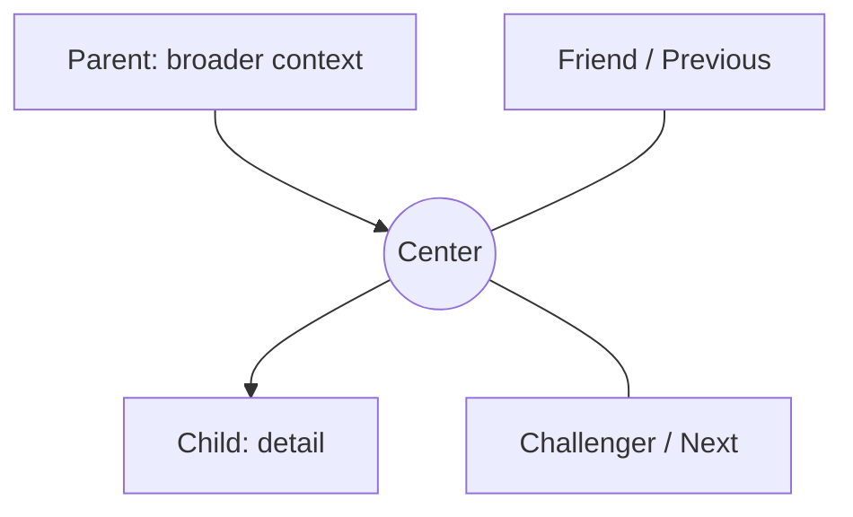

---
aliases:
- "The spatial relationship model"
tags:
- "kplex-help/concept"
- "kplex/concepts"
- "kplex/navigation"
Friend:
- "[[Navigating the Plex]]"
- '[[Idea Compass]]'
- '[[Relationship roles]]'
Previous:
- "[[What K-Plex is]]"
Next:
- "[[Relationship roles]]"
Watch out:
- '[[Layout density and typography]]'
Note type: "Concept"
learningMode: "read"
sessionSize: "longer"
map-role: concept
---
# The spatial relationship model

Understand a note at a glance in Compass, the default view. Read the space around it: broader context above, details below, related ideas to the left and challenges to the right.

![[Screenshot - Reading relationships.png]]

*The research example keeps a question and its surrounding context together. Open a neighbor to explore it.*

- **Parent** — above the center; broader category, source or containing idea.
- **Child** — below; subtopic, component, example or result.
- **Friend** — left; lateral, supportive or closely related idea.
- **Challenger** — right; opposing, competing or tension-producing idea.
- **Previous / Next** — left / right; ordered movement through a sequence.
- **Siblings** — a separate peripheral region; other children of the current node's parents.

A node can change position when the *center* changes, but its position still communicates the relationship it has to the new center. This predictable grammar is the main reason the canvas can remain readable even when the vault itself becomes large.

## Reverse the horizontal reading direction

Enable **Flip East–West axis** in **Settings → K-Plex → Canvas behavior → Views → Compass** to put Friends/Previous on the right and Challengers/Next on the left. Parent and Child keep their vertical positions. Gates, keyboard navigation and new-relationship defaults follow the displayed orientation; the fields in your notes keep the same meanings.

A Challenger can be a competing idea, a counterargument, or something that transforms or supercharges the center. Friends include similar, analogous and otherwise related ideas. Choose a field whose description makes the distinction clear for your own work.
