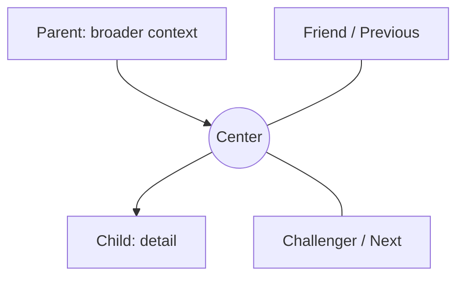

---
aliases:
- "The spatial relationship model"
tags:
- "kplex-help/concept"
- "kplex/concepts"
- "kplex/navigation"
Friend:
- "[[02 Navigate and explore/Navigating the Plex]]"
- '[[01 Core concepts/Idea Compass]]'
- '[[01 Core concepts/Relationship roles]]'
Previous:
- "[[01 Core concepts/What K-Plex is]]"
Next:
- "[[01 Core concepts/Relationship roles]]"
Watch out:
- '[[05 Personalize and workspace/Layout density and typography]]'
Note type: "Concept"
learningMode: "read"
sessionSize: "longer"
map-role: concept
---
# The spatial relationship model

Understand a note at a glance in Compass, the default view. Read the space around it: broader context above, details below, related ideas to the left and challenges to the right.

![[Assets/Screenshot - Reading relationships.png]]

*The research example keeps a question and its surrounding context together. Open a neighbor to explore it.*

- **Parent** — above the center; broader category, source or containing idea.
- **Child** — below; subtopic, component, example or result.
- **Friend** — left; lateral, supportive or closely related idea.
- **Challenger** — right; opposing, competing or tension-producing idea.
- **Previous / Next** — left / right; ordered movement through a sequence.
- **Siblings** — a separate peripheral region; other children of the current node's parents.

A node can change position when the *center* changes, but its position still communicates the relationship it has to the new center. This predictable grammar is the main reason the canvas can remain readable even when the vault itself becomes large.
