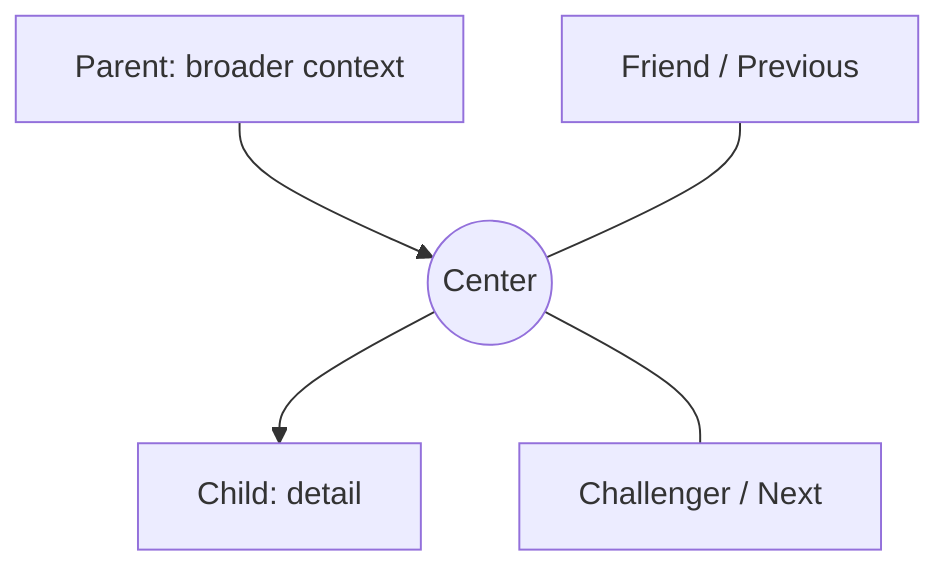

---
aliases:
  - "The spatial relationship model"
tags:
  - "kplex-help/concept"
  - "kplex/concepts"
  - "kplex/navigation"
Friend:
  - "[[02 Navigate and explore/Navigating the Plex]]"
Previous:
  - "[[01 Core concepts/What K-Plex is]]"
Next:
  - "[[01 Core concepts/Relationship roles]]"
---
K-Plex assigns stable spatial meaning to relationship roles:

- **Parent** — above the center; broader category, source or containing idea.
- **Child** — below; subtopic, component, example or result.
- **Friend** — left; lateral, supportive or closely related idea.
- **Challenger** — right; opposing, competing or tension-producing idea.
- **Previous / Next** — left / right; ordered movement through a sequence.
- **Siblings** — a separate peripheral region; other children of the current node's parents.

A node can change position when the *center* changes, but its position still communicates the relationship it has to the new center. This predictable grammar is the main reason the Plex can remain readable even when the vault itself becomes large.
